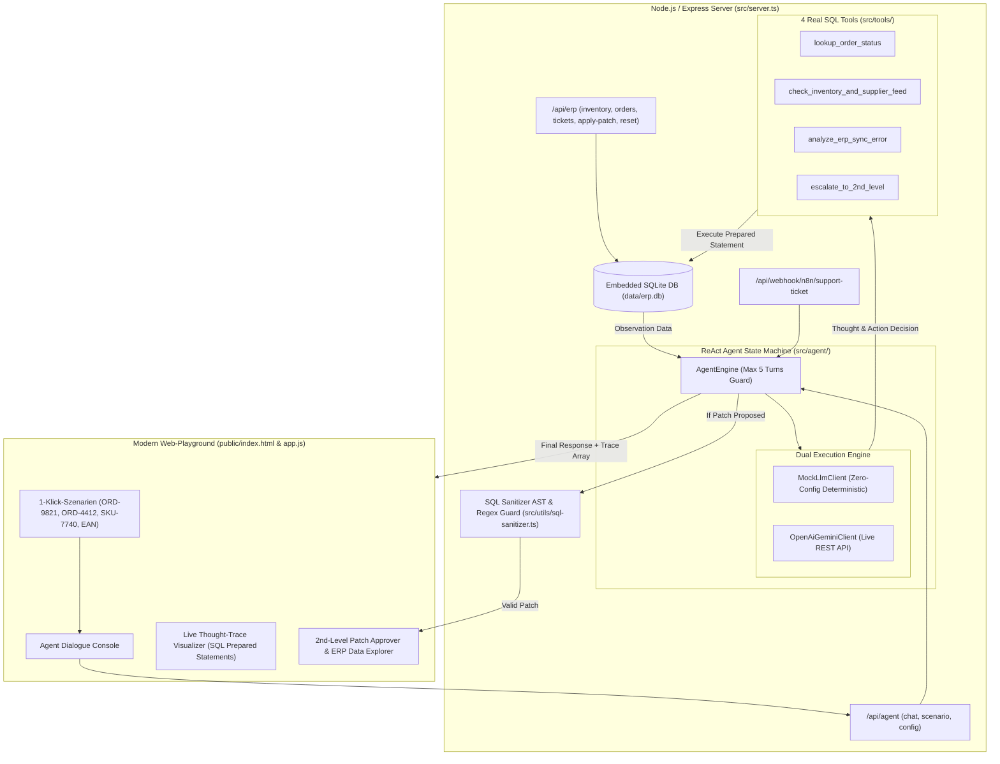

# Autonomous ERP & 1st/2nd-Level Support Agent

[](https://nodejs.org/)
[](https://www.typescriptlang.org/)
[](https://github.com/WiseLibs/better-sqlite3)
[](https://vitest.dev/)
[](https://tailwindcss.com/)
[](LICENSE)

> 🌐 **Sprache / Language:** [🇩🇪 Zur deutschen Version](#-deutsche-dokumentation) | [🇬🇧 Switch to English Version](#-english-documentation)

---

## 🇩🇪 Deutsche Dokumentation

Ein produktionsreifer, autonomer Multi-Step KI-Support-Agent für ERP- und Großhandelssysteme, implementiert nach dem **ReAct-Muster** (*Reasoning + Acting: Thought $\rightarrow$ Action $\rightarrow$ Observation $\rightarrow$ Final Answer*) mit **4 realen SQL-Tools**, **Dual-Execution-Engine** (deterministischer Zero-Config Mock oder echte LLM-APIs), **n8n Webhook-Pipeline** und interaktivem **Web-Playground mit Live-Thought-Trace & SQL-Inspector**.

---

### 🎯 Kern-Features & Recruiter-Highlights

- **Echte Agentic ReAct State-Machine:** Kein trivialer LLM-Chatbot oder Prompt-Wrapper, sondern eine robuste, auf maximal 5 Iterationen begrenzte Schleife mit dynamischer Toolauswahl und Kontexterweiterung.
- **4 SQL-gestützte Tools mit Prepared Statements:**
  1. `lookup_order_status`: Holt Auftragskopf, Positionen, Wawi-Sync-Status und Carrier-Tracking.
  2. `check_inventory_and_supplier_feed`: Ermittelt physische Bestände, Reservierungen, virtuelle Fehlmengen (`available_stock < 0`) und Lieferanten-Zuläufe mit ETA.
  3. `analyze_erp_sync_error`: Diagnostiziert reale ERP-Fehlercodes (`ERR_SQL_DEADLOCK_40001`, `ERR_INVENTORY_NEGATIVE_RESERVATION`, `ERR_INVALID_EAN_CHECK_SUM`) und leitet Ursachen & Handlungsanweisungen ab.
  4. `escalate_to_2nd_level`: Erstellt automatisch 2nd-Level-Tickets inklusive validiertem SQL-Patch.
- **Sicherheits-Gatekeeper (`sql-sanitizer`):** Validiert KI-generierte SQL-Patches strikt via AST/Regex-Whitelist: Nur `UPDATE`/`INSERT` auf erlaubte Tabellen (`inventory`, `orders`, etc.), zwingende `WHERE`-Klausel gegen Tabellen-Wipes, striktes Verbot von `DROP`, `DELETE`, `TRUNCATE`, Semikolons oder SQL-Kommentaren.
- **Dual-Execution Mode (Zero-Friction Evaluation):**
  - **Deterministischer Mock-LLM-Fallback:** Ermöglicht jedem Reviewer auf GitHub, das Projekt nach `git clone` mit `npm run dev` sofort ohne eigenen API-Key vollumfänglich und realitätsnah zu testen.
  - **Live LLM API:** Native Unterstützung für OpenAI (`gpt-4o-mini`) und Google Gemini (`gemini-1.5-flash`).
- **Interactive Web-Playground:**
  - **Live Thought-Trace:** Visualisiert Gedankengang, aufgerufenes Tool, exakt abgesetztes SQL Prepared Statement und Tabellen-Ergebnis.
  - **4 Instant-Szenario-Presets:** 1-Klick-Ausführung komplexer Fehlerfälle (Überbuchung, Deadlock, Tracking, EAN-Fehler).
  - **2nd-Level Patch Hub:** 1-Klick **"Apply SQL Patch"** führt den vorgeschlagenen Datenbank-Patch in einer atomaren SQLite-Transaktion aus und aktualisiert die Bestände in Echtzeit.
  - **Live ERP Explorer:** Übersicht über `inventory`, `orders`, `sync_error_logs` und `support_tickets`.
  - **Integrierter System-Guide & Architektur-Modal:** Direkt auf der Weboberfläche abrufbar via Button *"📖 System-Guide & Info"*.
- **n8n Workflow Automation:** Enthält eine produktionsreife `n8n-workflow.json` und den Webhook-Endpunkt `POST /api/webhook/n8n/support-ticket`.

---

### 🏗️ Systemarchitektur & ReAct Flow



---

### 🚀 Schnellstart

```bash
git clone https://github.com/Tom7668h/autonomous-erp-agent.git
cd autonomous-erp-agent
npm install
npm run dev
```

Dashboard im Browser öffnen: 👉 **http://localhost:3000**

---

### 🧪 Tests
```bash
npm test
```
```text
 ✓ tests/unit/sql-sanitizer.test.ts (7 tests)
 ✓ tests/unit/tools.test.ts (6 tests)
 ✓ tests/unit/agent-engine.test.ts (6 tests)
 ✓ tests/integration/api.test.ts (6 tests)

 Test Files  4 passed (4)
      Tests  25 passed (25)
```

---

<br><br>

---

## 🇬🇧 English Documentation

A production-grade, autonomous multi-step AI support agent for enterprise ERP and wholesale distribution, implemented following the **ReAct pattern** (*Reasoning + Acting: Thought $\rightarrow$ Action $\rightarrow$ Observation $\rightarrow$ Final Answer*) equipped with **4 real SQL tools**, **Dual-Execution Engine** (deterministic zero-config mock or live LLM APIs), **n8n Webhook Pipeline**, and an interactive **Web Playground with Live Thought-Trace & SQL Inspector**.

---

### 🎯 Key Features & Recruiter Highlights

- **Autonomous ReAct State-Machine:** Not a trivial chatbot prompt wrapper, but a resilient execution loop bounded to a maximum of 5 iterations with dynamic tool dispatching and memory augmentation.
- **4 SQL-Powered Prepared Statement Tools:**
  1. `lookup_order_status`: Queries order headers, line items, ERP sync statuses, and carrier tracking info.
  2. `check_inventory_and_supplier_feed`: Retrieves physical stock, allocated reservations, negative stock discrepancies, and inbound supplier shipments with ETAs.
  3. `analyze_erp_sync_error`: Diagnoses real-world ERP error codes (`ERR_SQL_DEADLOCK_40001`, `ERR_INVENTORY_NEGATIVE_RESERVATION`, etc.) and determines root causes.
  4. `escalate_to_2nd_level`: Automatically generates 2nd-level tickets containing validated SQL remediation patches.
- **Strict Security Gatekeeper (`sql-sanitizer`):** AST & regex whitelist: only `UPDATE`/`INSERT` on permitted tables, mandatory `WHERE` clauses, and strict prohibition of `DROP`, `DELETE`, `TRUNCATE`, semicolons, or comments.
- **Dual-Execution Mode:**
  - **Deterministic Mock LLM Fallback:** Enables any reviewer on GitHub to clone and test the complete agent immediately without API keys or costs.
  - **Live LLM API:** Native support for OpenAI (`gpt-4o-mini`) and Google Gemini (`gemini-1.5-flash`).
- **Interactive Web Playground:**
  - Real-time visualization of LLM thought steps, selected tools, SQL prepared statements, and observations.
  - 1-Click execution of real-world scenarios.
  - 1-Click **"Apply SQL Patch"** executing approved patches within atomic SQLite transactions.

---

### 🚀 Quickstart

```bash
git clone https://github.com/Tom7668h/autonomous-erp-agent.git
cd autonomous-erp-agent
npm install
npm run dev
```

Open dashboard: 👉 **http://localhost:3000**

---

### 📄 License
MIT © Tom7668h
