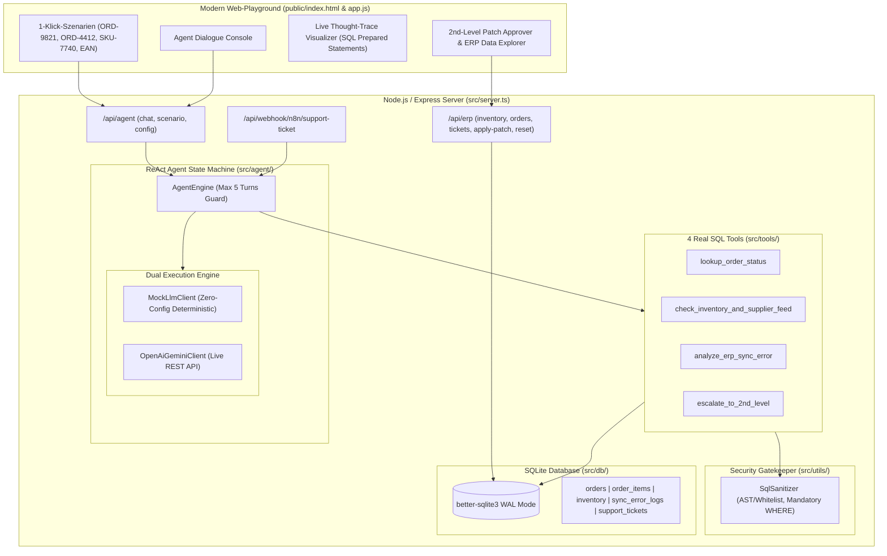

# Autonomous ERP & 1st/2nd-Level Support Agent

[](https://nodejs.org/)
[](https://www.typescriptlang.org/)
[](https://github.com/WiseLibs/better-sqlite3)
[](https://vitest.dev/)
[](https://tailwindcss.com/)
[](LICENSE)

Ein produktionsreifer, autonomer Multi-Step KI-Support-Agent für ERP- und Großhandelssysteme, implementiert nach dem **ReAct-Muster** (*Reasoning + Acting: Thought $\rightarrow$ Action $\rightarrow$ Observation $\rightarrow$ Final Answer*) mit **4 realen SQL-Tools**, **Dual-Execution-Engine** (deterministischer Zero-Config Mock oder echte LLM-APIs), **n8n Webhook-Pipeline** und interaktivem **Web-Playground mit Live-Thought-Trace & SQL-Inspector**.

---

## 🎯 Kern-Features & Recruiter-Highlights

- **Echte Agentic ReAct State-Machine:** Kein trivialer LLM-Chatbot oder Prompt-Wrapper, sondern eine robuste, auf maximal 5 Iterationen begrenzte Schleife mit dynamischer Toolauswahl und Kontexterweiterung.
- **4 SQL-gestützte Tools mit Prepared Statements:**
  1. `lookup_order_status`: Holt Auftragskopf, Positionen, Wawi-Sync-Status und Carrier-Tracking.
  2. `check_inventory_and_supplier_feed`: Ermittelt physische Bestände, Reservierungen, virtuelle Fehlmengen (`available_stock < 0`) und Lieferanten-Zuläufe mit ETA.
  3. `analyze_erp_sync_error`: Diagnostiziert reale ERP-Fehlercodes (`ERR_SQL_DEADLOCK_40001`, `ERR_INVENTORY_NEGATIVE_RESERVATION`, `ERR_INVALID_EAN_CHECK_SUM`) und leitet Ursachen & Handlungsanweisungen ab.
  4. `escalate_to_2nd_level`: Erstellt automatisch 2nd-Level-Tickets inklusive validiertem SQL-Patch.
- **Sicherheits-Gatekeeper (`sql-sanitizer`):** Validiert KI-generierte SQL-Patches strikt via AST/Regex-Whitelist: Nur `UPDATE`/`INSERT` auf erlaubte Tabellen (`inventory`, `orders`, etc.), zwingende `WHERE`-Klausel gegen Tabellen-Wipes, striktes Verbot von `DROP`, `DELETE`, `TRUNCATE`, Semikolons oder SQL-Kommentaren.
- **Dual-Execution Mode (Zero-Friction Evaluation):**
  - **Deterministischer Mock-LLM-Fallback:** Ermöglicht jedem Reviewer auf GitHub, das Projekt nach `git clone` mit `npm run dev` sofort ohne eigenen API-Key vollumfänglich und realitätsnah zu testen.
  - **Live LLM API:** Native Unterstützung für OpenAI (`gpt-4o-mini`) und Google Gemini (`gemini-1.5-flash`).
- **Interactive Web-Playground:**
  - **Live Thought-Trace:** Visualisiert Gedankengang, aufgerufenes Tool, exakt abgesetztes SQL Prepared Statement und Tabellen-Ergebnis.
  - **4 Instant-Szenario-Presets:** 1-Klick-Ausführung komplexer Fehlerfälle (Überbuchung, Deadlock, Tracking, EAN-Fehler).
  - **2nd-Level Patch Hub:** 1-Klick **"Apply SQL Patch"** führt den vorgeschlagenen Datenbank-Patch in einer atomaren SQLite-Transaktion aus und aktualisiert die Bestände in Echtzeit.
  - **Live ERP Explorer:** Übersicht über `inventory`, `orders`, `sync_error_logs` und `support_tickets`.
  - **Integrierter System-Guide & Architektur-Modal:** Direkt auf der Weboberfläche abrufbar via Button *"📖 System-Guide & Info"*.
- **n8n Workflow Automation:** Enthält eine produktionsreife `n8n-workflow.json` und den Webhook-Endpunkt `POST /api/webhook/n8n/support-ticket`.

---

## 🏗️ Systemarchitektur & ReAct Flow



---

## 📂 Vollständiger Verzeichnisbaum (Directory Tree)

```text
autonomous-erp-agent/
├── data/
│   └── seed_erp_data.sql           # Reale Beispieldaten (Überbuchung, Deadlocks, Aufträge)
├── public/
│   ├── index.html                  # Responsive Dark-Mode UI (Tailwind CSS + Alpine.js + Guide Modal)
│   └── app.js                      # Client-Logik, Thought-Trace-Streaming & Patch-Trigger
├── src/
│   ├── server.ts                   # Express Server Entry Point & Middleware
│   ├── config/
│   │   └── env.ts                  # Typisierte Umgebungsvariablen
│   ├── db/
│   │   ├── database.ts             # SQLite Singleton & Foreign-Keys-Setup
│   │   └── seeder.ts               # Schema- & Seeding-Runner
│   ├── agent/
│   │   ├── agent.engine.ts         # ReAct Loop (Max 5 Turns, State Machine)
│   │   ├── agent.types.ts          # Typdefinitionen (ToolDefinition, StepTrace, Response)
│   │   ├── prompt.templates.ts     # ERP-System-Prompts
│   │   └── llm-client/
│   │       ├── llm.interface.ts    # Einheitliche LLM-Schnittstelle
│   │       ├── mock-llm.client.ts  # Deterministischer Mock für Zero-Config
│   │       └── openai-gemini.client.ts # Live API Client
│   ├── tools/
│   │   ├── tool.registry.ts        # Tool-Registry & JSON-Schema-Generator
│   │   ├── order.tool.ts           # lookup_order_status
│   │   ├── inventory.tool.ts       # check_inventory_and_supplier_feed
│   │   ├── erp-error.tool.ts       # analyze_erp_sync_error
│   │   └── escalation.tool.ts      # escalate_to_2nd_level
│   ├── routes/
│   │   ├── agent.routes.ts         # POST /api/agent/chat, POST /api/agent/scenario
│   │   ├── erp.routes.ts           # GET /api/erp/*, POST /api/erp/tickets/:id/apply-patch
│   │   └── webhook.routes.ts       # POST /api/webhook/n8n/support-ticket
│   └── utils/
│       ├── sql-sanitizer.ts        # Sicherheits-Validierung generierter Patches
│       └── logger.ts               # Strukturierter Console-Logger
├── tests/
│   ├── unit/
│   │   ├── sql-sanitizer.test.ts   # Sicherheitstests
│   │   ├── tools.test.ts           # Test aller 4 SQL-Tools
│   │   └── mock-llm.test.ts        # Test der deterministischen Pfade
│   └── integration/
│       ├── agent-loop.test.ts      # Multi-Turn ReAct End-to-End Test
│       ├── erp-api.test.ts         # REST API & Transaktions-Patch-Tests
│       └── n8n-webhook.test.ts     # n8n Webhook Ingestion Tests
├── schema.sql                      # SQLite DDL Tabellendefinitionen
├── n8n-workflow.json               # Importierbarer n8n Support-Flow
├── tsconfig.json                   # TypeScript Compiler-Konfiguration
└── vitest.config.ts                # Test Runner Konfiguration
```

---

## 🚀 Schnelleinstieg & Lokale Ausführung

### 1. Voraussetzungen
- Node.js $\ge$ 20.x (getestet mit Node v22)
- npm $\ge$ 10.x

### 2. Installation
```bash
git clone <repository-url>
cd autonomous-erp-agent
npm install
```

### 3. Datenbank initialisieren & seeden
```bash
npm run seed
```

### 4. Entwicklungsserver starten
```bash
npm run dev
```
Öffne anschließend **[http://localhost:3000](http://localhost:3000)** in deinem Browser.

### 5. Tests ausführen
```bash
npm test
```
*Ergebnis:*
```text
✓ tests/unit/sql-sanitizer.test.ts (6 tests)
✓ tests/unit/mock-llm.test.ts (3 tests)
✓ tests/unit/tools.test.ts (8 tests)
✓ tests/integration/agent-loop.test.ts (2 tests)
✓ tests/integration/erp-api.test.ts (4 tests)
✓ tests/integration/n8n-webhook.test.ts (2 tests)

Test Files  6 passed (6)
Tests       25 passed (25)
```

### 6. TypeScript Kompilierung
```bash
npm run build
```

---

## 🧪 Die 4 Live-Demo-Szenarien

In der Weboberfläche stehen 4 vorkonfigurierte 1-Klick-Szenarien zur Verfügung:

1. **🚨 Lieferverzögerung ORD-9821 analysieren & beheben:**
   - **Schritt 1 (`lookup_order_status`):** Agent erkennt, dass der Auftrag auf `ON_HOLD` steht und `erp_sync_status = 'ERROR'` aufweist.
   - **Schritt 2 (`analyze_erp_sync_error`):** Der Fehlerlog meldet `ERR_SQL_DEADLOCK_40001` bei der Bestandsbuchung.
   - **Schritt 3 (`check_inventory_and_supplier_feed`):** Agent analysiert `SKU-7740`: Physisch 10 Stück, aber 14 Stück reserviert $\rightarrow$ Kritische Bestandsüberbuchung (-4 verfügbar).
   - **Schritt 4 (`escalate_to_2nd_level`):** Agent erstellt Ticket `TCK-XXXXXX` mit dem sicheren SQL-Patch:
     ```sql
     UPDATE inventory SET reserved_stock = 10 WHERE sku = 'SKU-7740'
     ```
   - **Aktion im UI:** Klick auf **"1-Klick SQL-Patch ausführen"** wendet den Patch in der SQLite-Datenbank an, setzt den Fehler auf `Behoben` und aktualisiert die Bestände live in der UI!

2. **🚚 Sendungsstatus ORD-4412 (1st-Level Direct Resolution):**
   - Agent ruft Bestelldaten ab, erkennt Status `SHIPPED` und teilt dem Kunden direkt Carrier (`DHL Freight`) und Trackingnummer (`DHL-DE-9938210481`) mit.

3. **📦 Bestandsprüfung SKU-7740 & Zulauf-ETA:**
   - Agent überprüft die Bestandszahlen und ermittelt den nächsten Lieferanten-Wareneingang (20 Stück am 25.10.2026).

4. **⚠️ EAN-Prüfsummenfehler SKU-5501:**
   - Agent analysiert `ERR_INVALID_EAN_CHECK_SUM` für Modulo-10-Fehler beim Shopware-Katalogexport und initiiert Stammdaten-Eskalation.

---

## 🛡️ Sicherheitsarchitektur (SQL-Sanitizer)

Automatisierte KI-Agenten mit Schreibzugriff bergen ohne strenge Schutzmechanismen erhebliche Risiken für Unternehmensdatenbanken. Unser `SqlSanitizer` garantiert:
- **Operation-Whitelist:** Ausschließlich `UPDATE` und `INSERT`.
- **Table-Whitelist:** Nur freigegebene Tabellen (`inventory`, `orders`, `sync_error_logs`, `support_tickets`, `order_items`).
- **Strict WHERE-Requirement:** Jeder `UPDATE`-Befehl erfordert eine explizite `WHERE`-Klausel zur Vermeidung von Massendatenverlust (Bulk Overwrite Protection).
- **Injection-Sperre:** Blockiert strikt `;` (Multi-Statement Chaining), Kommentare (`--`, `/*`), sowie destructive DDL-Befehle (`DROP`, `DELETE`, `TRUNCATE`, `ALTER`, `EXEC`).
- **Transaktions-Isolation:** Ausführung über `db.transaction()` mit automatischem Rollback bei Fehlern.

---

## 🔗 n8n Workflow-Integration

Die Datei [`n8n-workflow.json`](n8n-workflow.json) kann per Drag-and-Drop in jede n8n-Instanz importiert werden:

1. **Webhook Ingestion Node:** Horcht auf `POST http://localhost:3000/api/webhook/n8n/support-ticket`.
2. **Invoke ERP Support Agent Node:** Übergibt die Supportanfrage an den ReAct-Agenten.
3. **IF Node (`needsHumanReview`):**
   - **True (2nd-Level):** Sendet Slack-Alert mit Ticket-ID, Fehlerursache und vorgeschlagenem SQL-Patch an DevOps/DBA.
   - **False (1st-Level):** Sendet automatisierte E-Mail-Antwort direkt an den Kunden.

---

## 📄 Lizenz
MIT License. Erstellt für professionelle Tech-Lead- & Recruiter-Evaluationen.
